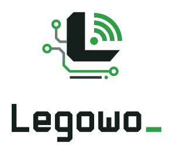
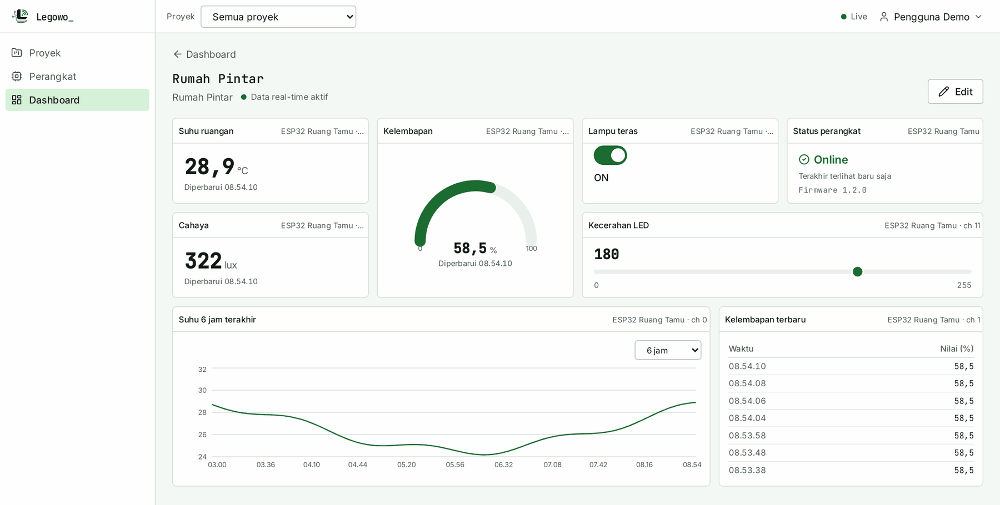
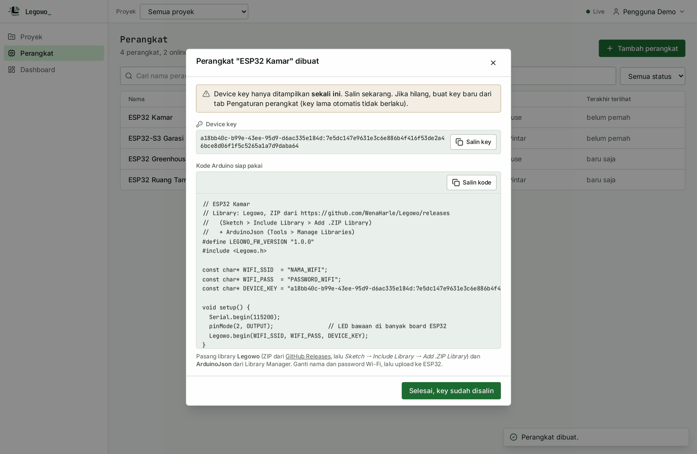
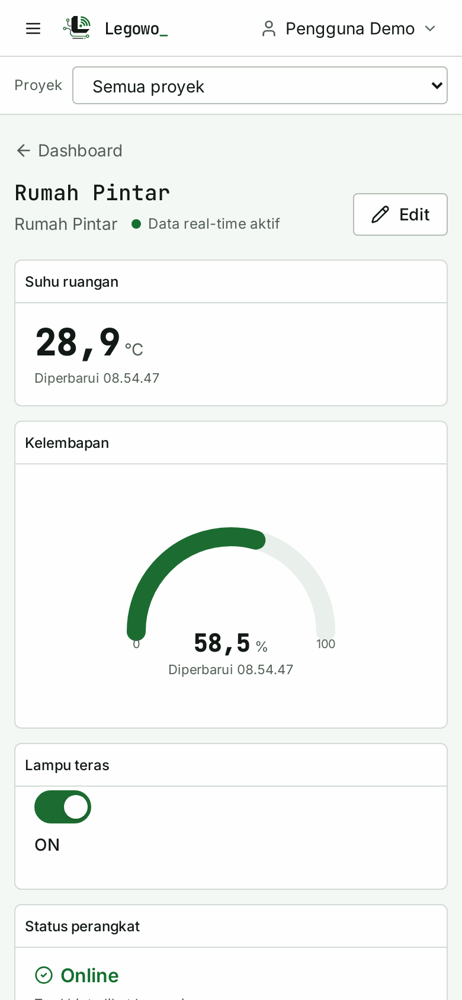
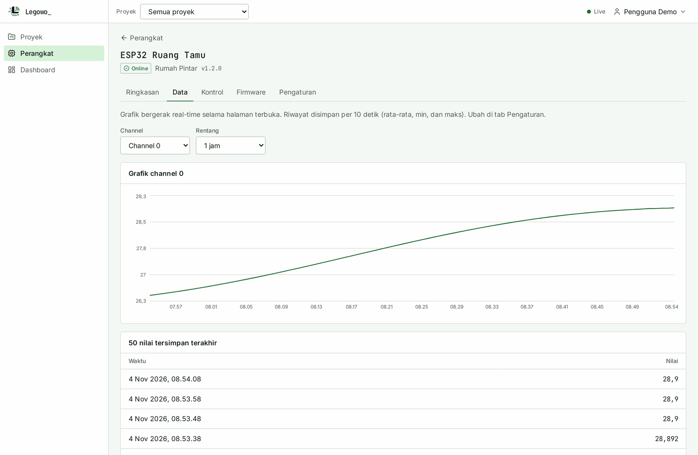

<p align="center">
  <picture>
    <source media="(prefers-color-scheme: dark)" srcset="docs/legowo-logo.svg">
    
  </picture>
</p>

# Legowo untuk Arduino

**Bahasa:** [English](README.md) · **Indonesia**

Library Arduino untuk menghubungkan **ESP32** ke platform IoT **Legowo**: kirim data sensor ke
dashboard, kendalikan pin dari dashboard, dan terima update firmware (OTA) dari server.

```cpp
#define LEGOWO_FW_VERSION "1.0.0"
#include <Legowo.h>

void setup() {
  Legowo.begin("NAMA_WIFI", "PASSWORD_WIFI", "DEVICE_KEY");   // key dari dashboard
}

void loop() {
  Legowo.run();                                               // tanpa delay()
}

LEGOWO_RECEIVE(10) {                                          // terima nilai dari dashboard -> channel 10
  digitalWrite(2, param.asInt());
}
```

Koneksi Wi-Fi, MQTT over WebSocket + TLS (sertifikat diverifikasi), reconnect otomatis, dan OTA
sudah ditangani library. Server default `lmqtt.madewena.com` sudah tertanam; tidak perlu mengatur apa pun.

## Tampilan aplikasi

<picture>
  <source media="(prefers-color-scheme: dark)" srcset="docs/screenshots/dashboard-dark.png">
  
</picture>

Dashboard dengan semua jenis widget: **nilai** (suhu, cahaya), **gauge** (kelembapan), **switch**
(lampu, channel 10), **status** perangkat, **slider** (PWM, channel 11), **grafik** riwayat, dan
**tabel** nilai terbaru. Nilai bergerak real-time; widget disusun bebas dengan mode *Edit*.

<table>
  <tr>
    <td width="62%"></td>
    <td rowspan="2"></td>
  </tr>
  <tr>
    <td></td>
  </tr>
  <tr>
    <td>Atas: <b>Tambah perangkat</b> langsung memberi kode Arduino siap salin. Bawah: tab <b>Data</b>
    perangkat (grafik dan nilai tersimpan).</td>
    <td>Tampilan ponsel.</td>
  </tr>
</table>

<sub>Gambar memakai data demo; device key di gambar sudah tidak berlaku.</sub>

## Mulai dalam 5 menit

1. **Pasang board ESP32** (sekali saja). Arduino IDE → *File → Preferences → Additional boards manager URLs*, isi:
   ```
   https://espressif.github.io/arduino-esp32/package_esp32_index.json
   ```
   Lalu *Tools → Board → Boards Manager* → cari **esp32** (Espressif Systems) → *Install*.
2. **Pasang library Legowo** (sekali saja):
   1. Unduh `Legowo-x.y.z.zip` dari [Releases](https://github.com/WenaHarle/Legowo/releases/latest)
      (jangan diekstrak).
   2. Arduino IDE → *Sketch → Include Library → Add .ZIP Library* → pilih file ZIP tadi.
   3. Pasang dependensinya: *Tools → Manage Libraries* → cari **ArduinoJson** (Benoit Blanchon) → *Install*.

   > Legowo sedang didaftarkan ke Arduino Library Manager. Setelah terdaftar, cukup *Tools → Manage
   > Libraries* → cari **Legowo** → *Install* (ArduinoJson ikut terpasang otomatis).
3. **Buat perangkat** di dashboard Legowo → *Perangkat → Tambah perangkat*. Salin kode yang muncul
   (device key hanya ditampilkan sekali).
4. **Tempel** kode ke Arduino IDE, isi nama dan password Wi-Fi (2.4 GHz).
5. Pilih board (mis. *ESP32 Dev Module*) dan port, lalu **Upload**. Buka *Serial Monitor* (115200):
   ```
   [Legowo] Wi-Fi terhubung, IP 192.168.1.23, sinyal -54 dBm
   [Legowo] Terhubung ke server Legowo. Device ID 3f2a...
   ```

Contoh lengkap ada di *File → Examples → Legowo*: `Basic`, `SwitchSlider`, `DHT_Sensor`, `RGB_LED`, `OTA_Update`.

## Channel

Nomor channel **bebas** (0 sampai 31). Peran channel **tidak** ditentukan oleh nomornya, melainkan
oleh cara Anda memakainya:

| Cara pakai | Arah | Peran | Contoh |
|---|---|---|---|
| `Legowo.write(ch, nilai)` / `bindSensor` | perangkat → dashboard | sensor | `Legowo.write(3, suhu);` |
| `LEGOWO_RECEIVE(ch){...}` / `onReceive` / `bindSwitch` / `bindSlider` | dashboard → perangkat | kontrol | `LEGOWO_RECEIVE(3) { ... }` |

Library otomatis memberi tahu server channel mana yang berperan kontrol (lewat pesan status), jadi
server tahu cara menyimpan histori tiap channel tanpa bergantung pada nomornya. Nilai yang diterima
dari dashboard otomatis dikirim balik sebagai konfirmasi, sehingga widget switch/slider menampilkan
keadaan sebenarnya di perangkat.

### Live dan tersimpan

Setiap nilai yang dikirim langsung tampil **real-time** di dashboard. Untuk riwayat grafik, server
menyimpan paling sering satu titik per channel per 10 detik (rata-rata, min, dan maks), atau per
interval yang dipilih di tab **Pengaturan** perangkat (10 detik sampai 5 menit). Channel kontrol
disimpan saat nilainya berubah. Jadi `setInterval()` menentukan seberapa cepat dashboard bergerak,
bukan seberapa banyak data yang disimpan. Server membatasi 20 pesan/detik per perangkat.

## API

| Fungsi | Keterangan |
|---|---|
| `Legowo.begin(ssid, pass, deviceKey)` | Mulai Wi-Fi + koneksi server (tidak memblokir). |
| `Legowo.run()` | Panggil terus di `loop()`. |
| `Legowo.write(ch, nilai)` | Kirim nilai ke dashboard (dikelompokkan tiap interval). |
| `Legowo.read(ch)` | Nilai terakhir channel. |
| `LEGOWO_RECEIVE(ch) { ... }` | Handler saat dashboard mengirim nilai; `param.asInt()`, `asFloat()`, `asBool()`. (`LEGOWO_WRITE` = nama lama yang masih didukung.) |
| `Legowo.onReceive(ch, fungsi)` | Sama seperti `LEGOWO_RECEIVE`, didaftarkan saat runtime. |
| `Legowo.bindSwitch(ch, pin, activeLow=false)` | Switch dashboard langsung mengendalikan pin. |
| `Legowo.bindSlider(ch, pin, min, max)` | Slider dashboard → PWM pin. |
| `Legowo.bindSensor(ch, pin, mode)` | Baca pin otomatis: `DIGITAL_NORMAL`, `DIGITAL_INVERTED`, `ANALOG_RAW`, `ANALOG_PERCENT`. |
| `Legowo.every(ms, fungsi)` | Jalankan fungsi berkala tanpa `delay()` (`Legowo.timer` untuk `setTimeout`/`cancel`). |
| `Legowo.setInterval(ms)` | Interval kirim telemetri dan baca sensor (default 2000 ms, minimum 200 ms). Lihat *Live dan tersimpan*. |
| `Legowo.setDebug(true)` | Log lebih rinci di Serial Monitor. |
| `Legowo.connected()` / `wifiConnected()` | Status koneksi. |
| `Legowo.disableOTA()` / `enableOTA()` | OTA **aktif secara default**. |

## Update firmware (OTA)

OTA sudah termasuk dan mengarah ke server Legowo (perintah lewat `lmqtt.madewena.com`, unduhan
lewat `https://ldev.madewena.com`). Upload pertama tetap lewat kabel USB; setelah itu sketch bisa
diperbarui tanpa kabel.

**Memasang sketch Anda sendiri**

1. Naikkan `LEGOWO_FW_VERSION` di sketch (mis. `"1.0.0"` → `"1.0.1"`).
2. Arduino IDE: *Sketch → Export Compiled Binary*. Buka folder sketch (`build/...`) dan ambil
   **`NamaSketch.ino.bin`**. Jangan pakai `.bootloader.bin`, `.partitions.bin`, atau `.merged.bin`;
   server menolak file itu karena perangkat tidak bisa boot jika memasangnya.
3. Di web app, buka perangkat → tab **Firmware** → **Firmware saya** → **Upload firmware**. Isi versi
   yang sama dengan `LEGOWO_FW_VERSION`, pilih file, centang *Langsung pasang ke perangkat ini*.

Firmware ini hanya terlihat oleh Anda dan hanya bisa dipasang ke perangkat Anda sendiri. Pastikan
sketch baru tetap memakai Legowo dengan OTA aktif; jika tidak, update berikutnya harus lewat USB lagi.

**Firmware resmi dari admin**

Admin bisa meng-upload firmware resmi untuk satu board (mis. `esp32`) lalu merilisnya atau menjalankan
rollout bertahap. Firmware resmi yang lebih baru muncul sebagai tombol *Update* di tab **Firmware**.

**Yang terjadi di perangkat**

1. Perangkat menerima perintah OTA, mengunduh lewat HTTPS dengan device key, lalu memeriksa
   **ukuran, SHA-256, dan tanda tangan** (jika `LEGOWO_OTA_PUBKEY` diisi).
2. Firmware ditulis ke slot OTA kedua, lalu perangkat restart.
3. Firmware baru dianggap sehat setelah berhasil terhubung lagi ke server. Jika tidak terhubung dalam
   5 menit atau restart berulang, perangkat **kembali otomatis ke firmware sebelumnya** dan melapor
   `rolled_back`.

Aturan keamanan: hanya versi **lebih baru** yang dipasang (anti-rollback), dan hanya URL dari
`LEGOWO_OTA_HOST` yang diterima.

**Tanda tangan (opsional).** Agar perangkat hanya mau memasang firmware yang Anda tanda tangani,
buat pasangan kunci ECDSA P-256 sekali di komputer Anda (butuh `openssl`):

```bash
openssl ecparam -name prime256v1 -genkey -noout -out ota_private.pem   # RAHASIA, jangan dibagikan
openssl ec -in ota_private.pem -pubout -out ota_public.pem
```

Salin isi `ota_public.pem` ke sketch sebagai `LEGOWO_OTA_PUBKEY` (setiap baris diakhiri `\n`, lihat
contoh `OTA_Update`). Untuk setiap `.bin`, buat tanda tangan lalu tempel di kolom *Tanda tangan*
saat upload:

```bash
openssl dgst -sha256 -sign ota_private.pem NamaSketch.ino.bin | base64 | tr -d '\n'
```

Setelah firmware dengan `LEGOWO_OTA_PUBKEY` terpasang, firmware tanpa tanda tangan yang cocok ditolak
perangkat, termasuk firmware resmi dari admin.

**Partition scheme** harus punya dua slot OTA. Skema default Arduino IDE untuk ESP32 (*Default 4MB with
spiffs*) sudah cukup. Jika memakai skema tanpa OTA (mis. *Huge APP*), Serial Monitor menampilkan peringatan.

## Pengaturan lanjutan

Tulis `#define` **sebelum** `#include <Legowo.h>`:

| Define | Default |
|---|---|
| `LEGOWO_FW_VERSION` | `"0.0.0"` |
| `LEGOWO_MQTT_HOST` | `"lmqtt.madewena.com"` (WSS port 443, path `/mqtt`) |
| `LEGOWO_OTA_HOST` | `"ldev.madewena.com"` |
| `LEGOWO_OTA_PUBKEY` | `""` (kosong = tanpa verifikasi tanda tangan) |
| `LEGOWO_TOPIC_PREFIX` | `"legowo"` |
| `LEGOWO_CA_CERT` | bundle root CA Let's Encrypt / Google Trust Services / Sectigo / SSL.com |
| `LEGOWO_BOARD` | otomatis dari chip (`esp32`, `esp32s3`, `esp32c3`, ...) |

## Pesan di Serial Monitor

| Pesan | Yang perlu dilakukan |
|---|---|
| `Format DEVICE_KEY salah` | Salin ulang device key dari dashboard (format `<id>:<64 karakter>`). |
| `Wi-Fi "X" tidak ditemukan` | Periksa nama Wi-Fi; ESP32 hanya mendukung 2.4 GHz. |
| `Tidak bisa masuk ke Wi-Fi` | Periksa password Wi-Fi. |
| `Tidak bisa terhubung ke ...` / `getaddrinfo() returns 202` | Perangkat dapat IP tapi DNS jaringan gagal me-resolve nama host. Sejak v1.1.1 library otomatis memakai fallback DNS publik; jika masih gagal, jaringan memblokir DNS keluar — coba Wi-Fi/hotspot lain. |
| `Device key ditolak server` | Key salah, sudah di-rotate, atau dicabut. Buat key baru di tab *Pengaturan* perangkat. |
| `Sertifikat server tidak valid` | Pastikan jam bisa sinkron (internet ke NTP) dan `LEGOWO_CA_CERT` tidak diubah. |
| `partition scheme tanpa slot OTA` | Pilih partition scheme dengan OTA di menu *Tools*. |

## ESP8266

Didukung secara eksperimental untuk telemetri dan kontrol, lewat MQTT TLS port 8883 ke
`LEGOWO_MQTT_TLS_HOST`. Server Legowo di `madewena.com` saat ini hanya membuka MQTT lewat WebSocket
(Cloudflare Tunnel), jadi ESP8266 baru bisa dipakai bila listener 8883 diaktifkan di server.
OTA belum didukung di ESP8266.

## Lisensi

[MIT](LICENSE) © 2026 Made Wena Harilegawa
