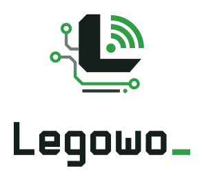

<p align="center">
  <picture>
    <source media="(prefers-color-scheme: dark)" srcset="docs/legowo-logo.svg">
    
  </picture>
</p>

# Legowo untuk Arduino

Library Arduino untuk menghubungkan **ESP32** ke platform IoT **Legowo**: kirim data sensor ke
dashboard, kendalikan pin dari dashboard, dan terima update firmware (OTA) dari server.

```cpp
#define LEGOWO_FW_VERSION "1.0.0"
#include <Legowo.h>

void setup() {
  Legowo.begin("NAMA_WIFI", "PASSWORD_WIFI", "DEVICE_KEY");   // key dari dashboard
}

void loop() {
  Legowo.run();                                               // tanpa delay()
}

LEGOWO_WRITE(10) {                                            // switch dashboard -> channel 10
  digitalWrite(2, param.asInt());
}
```

Koneksi Wi-Fi, MQTT over WebSocket + TLS (sertifikat diverifikasi), reconnect otomatis, dan OTA
sudah ditangani library. Server default `lmqtt.madewena.com` sudah tertanam; tidak perlu mengatur apa pun.

## Mulai dalam 5 menit

1. **Pasang board ESP32** (sekali saja). Arduino IDE → *File → Preferences → Additional boards manager URLs*, isi:
   ```
   https://espressif.github.io/arduino-esp32/package_esp32_index.json
   ```
   Lalu *Tools → Board → Boards Manager* → cari **esp32** (Espressif Systems) → *Install*.
2. **Pasang library Legowo** dengan salah satu cara:
   - **Library Manager**: *Tools → Manage Libraries* → cari **Legowo** → *Install* (ArduinoJson ikut terpasang otomatis).
   - **File ZIP**: unduh `Legowo-x.y.z.zip` dari [Releases](https://github.com/WenaHarle/Legowo/releases) →
     *Sketch → Include Library → Add .ZIP Library*.
3. **Buat perangkat** di dashboard Legowo → *Perangkat → Tambah perangkat*. Salin kode yang muncul
   (device key hanya ditampilkan sekali).
4. **Tempel** kode ke Arduino IDE, isi nama dan password Wi-Fi (2.4 GHz).
5. Pilih board (mis. *ESP32 Dev Module*) dan port, lalu **Upload**. Buka *Serial Monitor* (115200):
   ```
   [Legowo] Wi-Fi terhubung, IP 192.168.1.23, sinyal -54 dBm
   [Legowo] Terhubung ke server Legowo. Device ID 3f2a...
   ```

Contoh lengkap ada di *File → Examples → Legowo*: `Basic`, `SwitchSlider`, `DHT_Sensor`, `RGB_LED`, `OTA_Update`.

## Channel

| Channel | Arah | Contoh |
|---|---|---|
| 0–9 | perangkat → dashboard (sensor) | `Legowo.write(0, suhu);` |
| 10–31 | dashboard → perangkat (kontrol) | `LEGOWO_WRITE(10) { ... }` |

Nilai yang diterima dari dashboard otomatis dikirim balik sebagai konfirmasi, sehingga widget
switch/slider menampilkan keadaan sebenarnya di perangkat.

## API

| Fungsi | Keterangan |
|---|---|
| `Legowo.begin(ssid, pass, deviceKey)` | Mulai Wi-Fi + koneksi server (tidak memblokir). |
| `Legowo.run()` | Panggil terus di `loop()`. |
| `Legowo.write(ch, nilai)` | Kirim nilai ke dashboard (dikelompokkan tiap interval). |
| `Legowo.read(ch)` | Nilai terakhir channel. |
| `LEGOWO_WRITE(ch) { ... }` | Handler saat dashboard mengirim nilai; `param.asInt()`, `asFloat()`, `asBool()`. |
| `Legowo.onReceive(ch, fungsi)` | Sama seperti `LEGOWO_WRITE`, didaftarkan saat runtime. |
| `Legowo.bindSwitch(ch, pin, activeLow=false)` | Switch dashboard langsung mengendalikan pin. |
| `Legowo.bindSlider(ch, pin, min, max)` | Slider dashboard → PWM pin. |
| `Legowo.bindSensor(ch, pin, mode)` | Baca pin otomatis: `DIGITAL_NORMAL`, `DIGITAL_INVERTED`, `ANALOG_RAW`, `ANALOG_PERCENT`. |
| `Legowo.every(ms, fungsi)` | Jalankan fungsi berkala tanpa `delay()` (`Legowo.timer` untuk `setTimeout`/`cancel`). |
| `Legowo.setInterval(ms)` | Interval kirim telemetri dan baca sensor (default 2000 ms). |
| `Legowo.setDebug(true)` | Log lebih rinci di Serial Monitor. |
| `Legowo.connected()` / `wifiConnected()` | Status koneksi. |
| `Legowo.disableOTA()` / `enableOTA()` | OTA **aktif secara default**. |

## Update firmware (OTA)

OTA sudah termasuk dan mengarah ke server Legowo (perintah lewat `lmqtt.madewena.com`, unduhan
lewat `https://ldev.madewena.com`). Alurnya:

1. Naikkan `LEGOWO_FW_VERSION`, lalu *Sketch → Export Compiled Binary*.
2. Admin meng-upload `.bin` di web admin (*Firmware*), memilih board yang sama (mis. `esp32`), lalu
   merilis atau menjalankan rollout bertahap.
3. Perangkat mengunduh lewat HTTPS dengan device key, memeriksa **ukuran, SHA-256, dan tanda tangan**
   (jika `LEGOWO_OTA_PUBKEY` diisi), menulis ke slot OTA kedua, lalu restart.
4. Firmware baru dianggap sehat setelah berhasil terhubung lagi ke server. Jika tidak terhubung dalam
   5 menit atau restart berulang, perangkat **kembali otomatis ke firmware sebelumnya** dan melapor
   `rolled_back`.

Aturan keamanan: hanya versi **lebih baru** yang dipasang (anti-rollback), dan hanya URL dari
`LEGOWO_OTA_HOST` yang diterima. Untuk produksi, aktifkan tanda tangan firmware: buat kunci di mesin build
(`scripts/ota-sign.sh` di repo server), isi `LEGOWO_OTA_PUBKEY` di sketch dan `OTA_PUBLIC_KEY` di server.

**Partition scheme** harus punya dua slot OTA. Skema default Arduino IDE untuk ESP32 (*Default 4MB with
spiffs*) sudah cukup. Jika memakai skema tanpa OTA (mis. *Huge APP*), Serial Monitor menampilkan peringatan.

## Pengaturan lanjutan

Tulis `#define` **sebelum** `#include <Legowo.h>`:

| Define | Default |
|---|---|
| `LEGOWO_FW_VERSION` | `"0.0.0"` |
| `LEGOWO_MQTT_HOST` | `"lmqtt.madewena.com"` (WSS port 443, path `/mqtt`) |
| `LEGOWO_OTA_HOST` | `"ldev.madewena.com"` |
| `LEGOWO_OTA_PUBKEY` | `""` (kosong = tanpa verifikasi tanda tangan) |
| `LEGOWO_TOPIC_PREFIX` | `"legowo"` |
| `LEGOWO_CA_CERT` | bundle root CA Let's Encrypt / Google Trust Services / Sectigo / SSL.com |
| `LEGOWO_BOARD` | otomatis dari chip (`esp32`, `esp32s3`, `esp32c3`, ...) |

## Pesan di Serial Monitor

| Pesan | Yang perlu dilakukan |
|---|---|
| `Format DEVICE_KEY salah` | Salin ulang device key dari dashboard (format `<id>:<64 karakter>`). |
| `Wi-Fi "X" tidak ditemukan` | Periksa nama Wi-Fi; ESP32 hanya mendukung 2.4 GHz. |
| `Tidak bisa masuk ke Wi-Fi` | Periksa password Wi-Fi. |
| `Device key ditolak server` | Key salah, sudah di-rotate, atau dicabut. Buat key baru di tab *Pengaturan* perangkat. |
| `Sertifikat server tidak valid` | Pastikan jam bisa sinkron (internet ke NTP) dan `LEGOWO_CA_CERT` tidak diubah. |
| `partition scheme tanpa slot OTA` | Pilih partition scheme dengan OTA di menu *Tools*. |

## ESP8266

Didukung secara eksperimental untuk telemetri dan kontrol, lewat MQTT TLS port 8883 ke
`LEGOWO_MQTT_TLS_HOST`. Server Legowo di `madewena.com` saat ini hanya membuka MQTT lewat WebSocket
(Cloudflare Tunnel), jadi ESP8266 baru bisa dipakai bila listener 8883 diaktifkan di server.
OTA belum didukung di ESP8266.

## Lisensi

MIT
